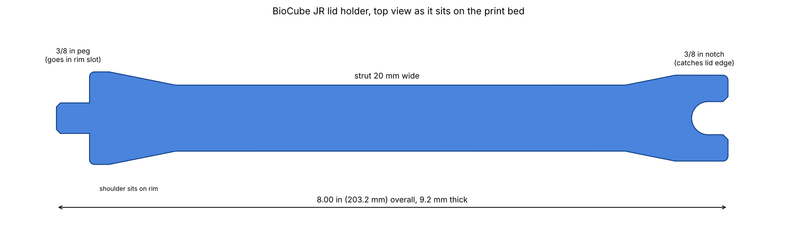

# BioCube JR lid holder

Prop that holds the BioCube JR hood open. The 3/8 in peg drops into the slot in
the tank rim, the wide shoulder sits on the rim, and the 3/8 in U notch at the
top catches the lid edge so the lid can't slide off. 8 in overall.

## Files

| File | What it is |
| --- | --- |
| `biocube_jr_lid_holder.stl` | The holder |
| `fit_test_peg.stl` | Peg end only, print first to check the rim slot fit |
| `fit_test_notch.stl` | Notch end only, print first to check the lid edge fit |
| `make_lid_holder.py` | Generator, change `PEG_CLEARANCE` / `NOTCH_CLEARANCE` and rerun if the fit is off |

## Print settings

* Material: PETG (PLA works but the LEDs get warm and the hood is humid, PLA can creep over time)
* Orientation: lying flat, exactly as the STL loads. No supports.
* Layer height: 0.2 mm
* Walls: 4 perimeters
* Top/bottom: 5 layers
* Infill: 40% gyroid
* Brim: optional, 5 mm if your PETG lifts at the ends
* Elephant foot compensation on (or lightly sand the bottom edge of the peg)

## Strength check

Part is 20 x 9.2 mm in section. Euler buckling for an 8 in pinned PETG column is
about 620 N (140 lbf). The hood weighs a few pounds and the prop only carries part
of that since the hinge takes the rest, so the margin is huge. Printed flat, the
load runs along the extrusion lines, which is the strongest direction for FDM.

Regenerate with `pip install trimesh shapely mapbox_earcut && python3 make_lid_holder.py`.
